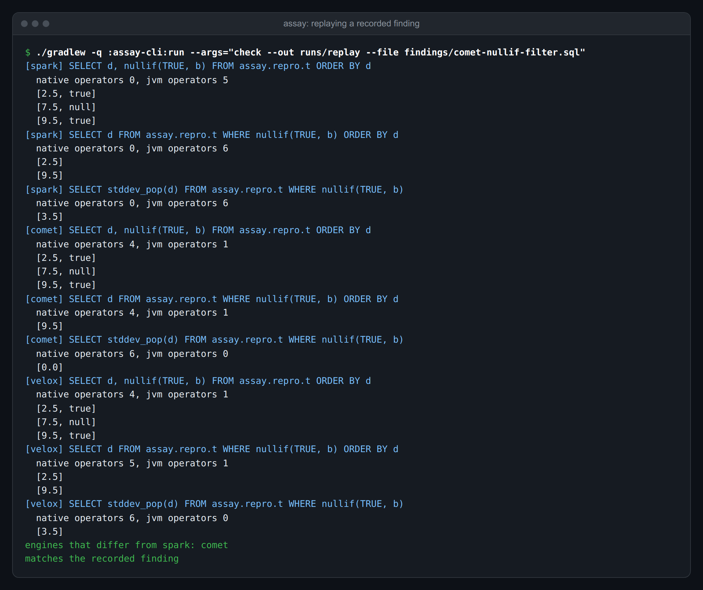
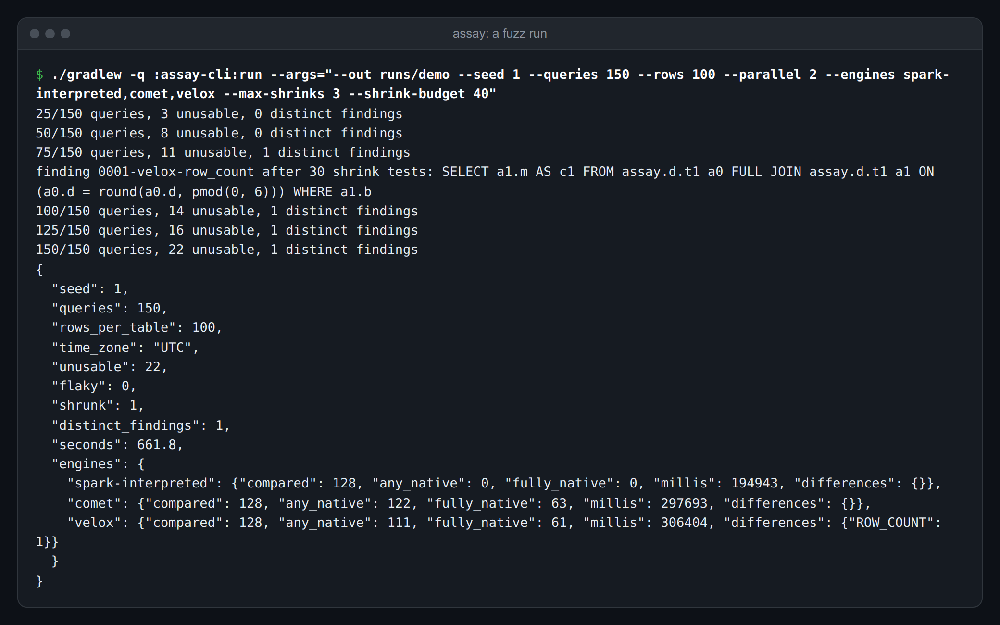
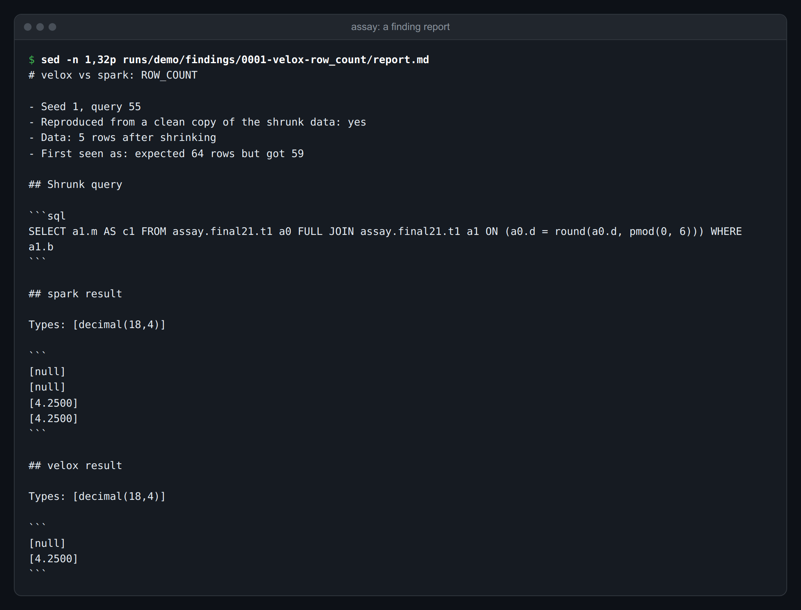

# Assay

Assay checks whether a faster query engine gives the same answers as Apache Spark.

Companies switch on [Apache Comet](https://datafusion.apache.org/comet/) or
[Velox](https://velox-lib.io/) (through [Apache Gluten](https://gluten.apache.org/)) to cut
Spark's compute bill. Both replace Spark's JVM operators with native code and promise the same
results. When one of them rounds a number differently or mishandles a null, the query still
succeeds and a report is quietly wrong.

## What it does

- Generates random SQL over [Apache Iceberg](https://iceberg.apache.org/) tables full of awkward
  values: nulls, NaN, huge decimals, emoji and extreme dates.
- Runs each query on Spark, Comet and Velox, and compares the answers exactly as
  [Apache Arrow](https://arrow.apache.org/) data.
- Shrinks every difference down to a small query and a few rows, and writes a report with a
  script that reproduces it.
- Runs queries concurrently across as many sets of engines as you ask for. Two sets finished the
  same 100 queries in 452 seconds instead of 805, with identical results.

## Try it

You need Java 21. The build fetches everything else, including the engines.

```sh
./gradlew build
./gradlew -q :assay-cli:run --args="check --out runs/replay --file findings/comet-nullif-filter.sql"
```

`check` replays a recorded bug on every engine and prints each answer side by side. Here Comet's
filter loses the row with `2.5`, so its `stddev_pop` is `0.0` where Spark and Velox return `3.5`:



Every file in [findings/](findings) is a reproduction you can replay the same way. CI replays them
all and fails if a recorded bug stops reproducing.

## Look for new bugs

```sh
./gradlew -q :assay-cli:run --args="--out runs/demo --seed 1 --queries 150 --parallel 2 \
  --engines spark-interpreted,comet,velox --max-shrinks 3 --shrink-budget 40"
```

`spark-interpreted` is a control: Spark checked against itself, which catches mistakes in the
generator. The same seed generates the same queries and data. Each lane in `--parallel` runs its
own set of JVMs, so memory is the limit. Add `--tz ZONE` to run in another session time zone.



Each finding gets a directory under `runs/<name>/findings` with `report.md`, a `repro.sql` and the
Arrow results from both engines. `results.tsv` records the outcome of every query, and
`summary.json` has the counts.



## What it has found

These runs used Spark 4.0.2, Iceberg 1.11.0, Comet 1.2.0 and Gluten 1.7.0 with its bundled Velox.
Details and reproductions are in [FINDINGS.md](FINDINGS.md).

| Engine | Finding | Effect | Upstream status |
|---|---|---|---|
| Velox | Filtering a double column in a Parquet file that also holds NaN | Loses every row in the row group: `d > 0.0` returned nothing where the file holds `5.25` | No report found |
| Comet | `WHERE nullif(TRUE, b)` when `b` is NULL | Silently drops the row, though the same expression selected as a column returns `true`. `stddev_pop` over the filter returned 0.0 where Spark returned 3.5 | No report found |
| Velox | `lpad` and `rpad` with an empty padding string | The whole query fails where Spark returns a value | Reported: [velox#20207](https://github.com/facebookincubator/velox/issues/20207) |
| Velox | `upper` and `initcap` on `ß` | Returns `ẞ` where Spark returns `SS`, so a group or join on the result differs | Reported: [velox#20208](https://github.com/facebookincubator/velox/issues/20208) |
| Velox | `round(double, 0)` changes large values, and the largest double becomes `Infinity` | A filter on the rounded value dropped 4 of 5 rows | Known in part: [velox#19422](https://github.com/facebookincubator/velox/pull/19422) is open |
| Velox | `second()` and `date_trunc('MINUTE')` in a time zone with a sub-minute offset | Wrong for historic timestamps, such as New York before 1883 | No report found |
| Velox | `CAST(date AS STRING)` after year 9999 | Prints `10000-09-30` where Spark prints `+10000-09-30` | No report found |
| Velox | `CAST(double AS STRING)` on the smallest double | Prints `4.9406564584124654E-324` where Spark prints `4.9E-324` | No report found |
| Velox | `power(1.0, Infinity)` | Returns `1.0` where Spark returns `NaN`, so a filter on it keeps extra rows | No report found |
| Velox | `round(x, NULL)` | Rounds as if the scale were 0 where Spark returns null | No report found |
| Velox | `CAST(double AS DECIMAL)` on large values | Returns `-9223372036854775808` where Spark returns `-9223372036854776000` | No report found |
| Comet | `lpad` with a NULL padding value | The whole query fails where Spark returns a value | Related open work: [comet#7450](https://github.com/apache/datafusion-comet/pull/7450), [comet#7452](https://github.com/apache/datafusion-comet/issues/7452) |
| Velox and Comet | Math functions such as `cbrt` differ from Spark in the last bits | Velox returns `3.0000000000000004` for `cbrt(27.0)`. Comet differs by one bit on `cbrt(2.5)`. Later steps such as `hash`, `%` or `cos` turn that into a visibly different answer | Comet: known, [comet#6797](https://github.com/apache/datafusion-comet/issues/6797) |
| Comet | `CAST(date AS TIMESTAMP)` in a daylight-saving zone | From 2100 onward it is one hour off in New York summer time. 2038 is still correct | No report found |
| Spark, on every engine | `d > 0.0` on NaN depends on how the table was written | The NaN row is returned when both rows share a file and dropped when they do not | No report found |
| Spark | Negating the largest `DECIMAL(38,10)` | Raises an error where Comet and Velox return the value | No report found |
| Spark | `LIKE` with a non-literal pattern containing an emoji | `'🦀' LIKE p` is false where `p` is `'🦀'`. Comet and Velox are correct | Fix proposed upstream as SPARK-55453; Spark 4.0.2 still shows it |

| Run | Queries compared | Comet: any native / fully native | Velox: any native / fully native | Differences: control, Comet, Velox |
|---|---|---|---|---|
| Seed 1, UTC, laptop | 86 | 83 / 45 | 75 / 44 | 0, 0, 1 |
| Seed 2, UTC, laptop | 536 | 506 / 216 | 456 / 200 | 0, 0, 5 |
| Seed 3, New York, laptop | 361 | 345 / 165 | 320 / 156 | 0, 1, 18 |
| Seed 3, UTC, GitHub Actions | 537 | 513 / 238 | 465 / 221 | 0, 2, 29 |
| Seed 4, UTC, GitHub Actions | 549 | 508 / 215 | 467 / 201 | 0, 1, 18 |
| Seed 5, UTC, GitHub Actions | 539 | 510 / 223 | 463 / 205 | 2, 3, 25 |
| Seed 5, UTC, Actions, fixed generator | 537 | 508 / 222 | 461 / 204 | 0, 3, 24 |
| Seed 8, UTC, Actions, fixed generator | 535 | 498 / 196 | 460 / 183 | 0, 1, 9 |
| Seed 9, UTC, Actions, fixed generator | 536 | 502 / 218 | 453 / 204 | 0, 1, 10 |
| Seed 6, New York, Actions, fixed generator | 540 | 500 / 207 | 450 / 196 | 0, 1, 19 |
| Seed 7, New York, Actions, fixed generator | 521 | 481 / 210 | 451 / 188 | 1, 4, 21 |
| Total | 5,277 | 4,954 / 2,155 | 4,521 / 2,002 | 3, 17, 179 |

The 2 control differences on the first seed 5 run were a generator mistake: a `SUM` of decimals
near the type's limit overflows or not depending on row order. Arguments to decimal sums and
averages are now bounded, as double aggregates already were, and the rerun of that seed was clean.
The 1 control difference on seed 7 is the decimal negation error above: Spark raises it in either
mode when it evaluates that expression, and only one mode reached it for that query.

Spark rejected the other generated queries, which says nothing about any engine. A difference is
counted each time a query shows one, so the counts reduce to the causes above. Reports that did
not reproduce on replay are not claimed as bugs, and [FINDINGS.md](FINDINGS.md) lists the ones
still open.

A clean result shows only that these queries found no difference. Less than half of them ran
fully natively on either engine, and the rest mixed native and JVM operators.

## How it works

```
                 seed
                  |
        generate data and queries
                  |
   +--------------+---------------+
   |          |          |        |
 Spark     Spark       Comet    Velox      one JVM each, reading
 (reference) (interpreted,                 the same Iceberg tables
   |        control)     |        |
   +--------------+---------------+
                  |
     results written as Arrow files
                  |
      exact comparison, then recheck
                  |
   shrink the query, then the rows
                  |
   report.md and repro.sql for each finding
```

**One JVM per engine.** Comet and Gluten both patch Spark, so they cannot share a process. A
native crash then kills only its own worker, and it becomes a finding. The coordinator has no
Spark on its classpath and talks to workers over a small line protocol.

**Queries have one correct answer.** The generator leaves out anything two correct engines may
legitimately answer differently. That means no `rand()` or `first()`, window functions ordered
by a unique row id, and `LIMIT` only with a total ordering. Floating-point aggregates only see
bounded inputs, because a sum over values near 1e308 depends on the order rows arrive in.

**Data aims at known weak spots.** Columns mix a small domain, so joins find matches, with nulls,
NaN, infinities, negative zero, integer and decimal limits, awkward strings and extreme dates.
The four tables differ physically: a plain table, one split into several files, one partitioned
by a bucket transform, and one with merge-on-read delete files. Random join hints force the
broadcast, sort-merge and shuffle-hash paths.

**The comparison is strict where it can be.** Integers, decimals, strings and dates must match
exactly. Doubles get a relative tolerance of 1e-9, because parallel sums legitimately differ in
the last bits. Negative zero against positive zero is reported as its own, softer kind.

**Nothing is reported unless it recurs.** A difference has to repeat twice more before Assay
treats it as a finding. Shrinking removes query clauses and sub-expressions greedily, then uses
delta debugging on the rows, and the result is rechecked from a clean copy of the data.

**Two checks keep the results honest.** Spark in interpreted mode, with code generation and
adaptive execution off, runs as a control: a difference there points at the generator or at
Spark. Assay also reads each final physical plan and counts native operators, so a query that
quietly fell back to the JVM cannot pass as evidence for a native engine. The plan has to be read
after execution, since Gluten rewrites plans inside adaptive execution.

## Limits

- Spark is the reference, so a bug shared by Spark and the native engine is invisible, and a Spark
  bug looks like a native one until someone checks. The `LIKE` finding above is one such case. Each
  finding in [FINDINGS.md](FINDINGS.md) was checked against the expected semantics or Spark's source.
- ANSI mode is off, because Gluten 1.7 documents it as unsupported on Spark 4.0.
- Generated queries use scalar types only. Arrays, maps and structs are not covered.
- Tables hold a few hundred rows. That exercises semantics, but not spilling or memory pressure.
- Comet's default settings keep incompatible expressions on the JVM, so its clean result applies
  to that configuration.

## Layout

| Module | Contents |
|---|---|
| `assay-core` | SQL model, function catalog, data and query generators, comparison, shrinking |
| `assay-worker` | Runs on the engine's classpath, executes SQL, writes Arrow results |
| `assay-cli` | Coordinator: starts workers, drives the fuzz loop, writes reports |

Adding a function to the fuzzer is one line in `Catalog.java`.

## License

Apache 2.0
